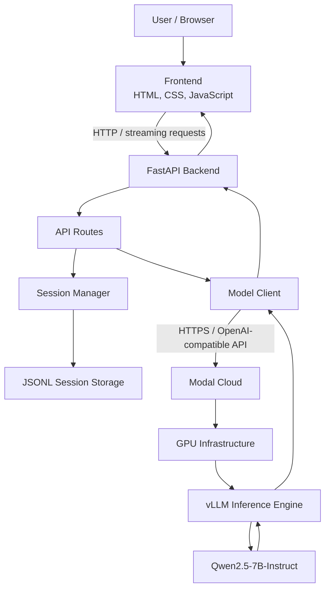
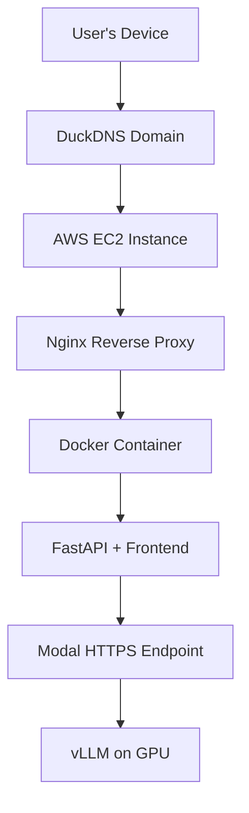

# NeuralForge ⚡

### A Self-Hosted, Cloud-Powered AI Coding Assistant Platform

NeuralForge is a modular AI assistant platform built around open-source language models. It provides a browser-based interface for interacting with a remotely hosted LLM, while keeping the application backend independent from the GPU infrastructure used for inference.

The current implementation uses **Qwen2.5-7B-Instruct**, served through **vLLM on Modal GPU infrastructure**, with a **FastAPI** backend and a lightweight HTML, CSS and JavaScript frontend.

NeuralForge is being developed as both:
- A powerful personal AI coding assistant.
- A portfolio and research-engineering project exploring the infrastructure required to deploy customizable AI assistants for individuals and small organizations.

The longer-term direction is to support document understanding, retrieval-augmented generation (RAG), controlled tool use, multi-user access, and organization-specific permissions—without redesigning the core application architecture for every new capability.

---

## ✨ Current Features

- **Remote LLM inference:** Run an open-source language model on cloud GPU infrastructure without requiring a local GPU.
- **vLLM model serving:** Communicate with the model through an OpenAI-compatible API.
- **FastAPI backend:** Handle chat requests, streaming responses, health checks and session management.
- **Browser-based chat interface:** Frontend built with HTML, CSS and JavaScript.
- **Streaming responses:** Stream generated text from the backend to the browser.
- **Session management:** Create, retrieve, list and delete conversations.
- **Persistent conversations:** Store messages in individual JSONL session files.
- **Containerized deployment:** Package the application using Docker.
- **Remote application hosting:** Run the application on an AWS EC2 instance.
- **Independent inference infrastructure:** Keep the application server separate from the GPU-backed model server.
- **Mock mode:** Exercise the application without activating remote GPU inference.

## 🧭 Design Philosophy

The central application architecture is intended to remain stable as NeuralForge grows.

The frontend communicates with a FastAPI backend. The backend coordinates sessions, model requests and supporting services. New capabilities—such as file processing, web search and RAG—can be introduced as separate backend modules and exposed through additional API endpoints.

This keeps the system modular: adding a capability should generally extend the backend rather than require a complete architectural redesign.

---

## 🏗️ Architecture

### Current architecture



### Request lifecycle

1. A user submits a prompt through the browser interface.
2. The frontend sends the request to a FastAPI endpoint.
3. The backend retrieves the relevant conversation history.
4. The model client sends the conversation to the remote Modal inference endpoint.
5. vLLM executes inference using Qwen2.5-7B-Instruct on the provisioned GPU.
6. The assistant response is saved in the session's JSONL file.
7. FastAPI returns the response—or streams generated text—to the browser.

### Deployment architecture



The application server and model inference server are independent. The EC2 instance hosts the web application and API, while Modal provisions GPU resources for model inference.

---

## 🛠️ Technology Stack

| Component | Technology |
|---|---|
| Programming language | Python |
| Frontend | HTML, CSS, JavaScript |
| Backend framework | FastAPI |
| ASGI server | Uvicorn |
| Language model | Qwen2.5-7B-Instruct |
| Inference engine | vLLM |
| GPU inference platform | Modal |
| API client | OpenAI Python SDK |
| Session storage | JSONL files |
| Configuration | python-dotenv |
| Containerization | Docker |
| Application hosting | AWS EC2 |
| Container registry | Amazon ECR |
| Reverse proxy | Nginx |
| Domain | DuckDNS |
| HTTPS | Let's Encrypt / Certbot |

---

## 📁 Project Structure

```text
NeuralForge/
├── backend/
│   ├── __init__.py
│   ├── main.py
│   ├── config.py
│   ├── model_client.py
│   └── session_manager.py
├── frontend/
│   ├── index.html
│   ├── style.css
│   └── script.js
├── modal_deployment/
│   ├── deploy.py
│   ├── gpu_test.py
│   └── test_vllm_1.py
├── storage/
│   └── sessions/
├── Dockerfile
├── docker-compose.yml
├── .dockerignore
├── .env                  # Create locally; never commit
├── .gitignore
├── requirements.txt
└── README.md
```

The `storage/` directory contains local session data during development. In the Docker deployment, persistent session data is mounted through a named Docker volume.

---

## ⚙️ Getting Started

### Prerequisites

- Python 3.10 or later
- Git
- A Modal account for remote inference
- Modal CLI configured for your account

Docker is optional for local development, but required if you want to run the application using the provided container configuration.

### 1. Clone the repository

```bash
git clone https://github.com/YOUR_USERNAME/YOUR_REPOSITORY.git
cd YOUR_REPOSITORY
```

Replace the URL with your actual GitHub repository URL.

### 2. Create and activate a virtual environment

**Linux / macOS:**

```bash
python3 -m venv .venv
source .venv/bin/activate
```

**Windows PowerShell:**

```powershell
python -m venv .venv
.venv\Scripts\Activate.ps1
```

### 3. Install dependencies

```bash
pip install -r requirements.txt
```

### 4. Configure environment variables

Create a `.env` file in the project root:

```env
MODAL_BASE_URL=https://YOUR_MODAL_ENDPOINT/v1
VLLM_API_KEY=your_api_key
MODEL_NAME=qwen2.5-7b
MODEL_MOCK=true
```

Use the endpoint generated by your Modal deployment. The API key must match the secret configured for the Modal application.

**Security reminders:**
- Never commit `.env`.
- Never expose the inference API key in frontend JavaScript.
- Do not include secrets in screenshots, logs or public issue reports.
- Use a separate secret-management mechanism for production deployments.

### 5. Run locally in mock mode

Keep the following setting in `.env`:

```env
MODEL_MOCK=true
```

Start the backend from the repository root:

```bash
uvicorn backend.main:app --reload
```

Open the application at `http://127.0.0.1:8000`.

FastAPI's interactive API documentation is available at `http://127.0.0.1:8000/docs`.

Mock mode exercises the application without sending inference requests to Modal.

---

## ☁️ Deploying the Model on Modal

NeuralForge uses Modal to host the GPU-backed vLLM inference server.

### 1. Install and authenticate the Modal CLI

```bash
pip install modal
modal setup
```

Complete the authentication flow.

### 2. Create the Modal secret

The deployment expects a secret named `qwen-api-secret` containing `VLLM_API_KEY`.

```bash
modal secret create qwen-api-secret VLLM_API_KEY=YOUR_SECRET
```

Use the same secret value in the application's `.env` file. Do not publish it.

### 3. Deploy the inference application

From the repository root:

```bash
modal deploy modal_deployment/deploy.py
```

Use the endpoint URL printed by Modal as `MODAL_BASE_URL`, appending `/v1` where required by the deployment.

The first request may take longer while Modal provisions GPU resources and vLLM loads the model. Model and inference caches may use the persistent Modal Volumes configured by the deployment.

### 4. Enable real inference

Set the following in `.env`:

```env
MODEL_MOCK=false
```

Restart the backend so it reloads the environment configuration:

```bash
uvicorn backend.main:app --reload
```

Send a prompt through the web interface. FastAPI forwards the request to the Modal-hosted model.

**Cost note:** GPU usage is subject to Modal's current pricing and deployment configuration. Check the Modal dashboard and stop or scale down GPU resources when they are not needed.

---

## 🐳 Running with Docker

Build and start the application from the repository root:

```bash
sudo docker compose up -d --build
```

View container status:

```bash
sudo docker compose ps
```

View application logs:

```bash
sudo docker compose logs -f
```

Stop the application:

```bash
sudo docker compose down
```

The Compose configuration uses a named Docker volume for `/app/storage`, preserving session data when the application container is recreated. Do not use `docker compose down -v` unless you intentionally want to delete the named volume and its stored data.

The container reads environment variables from the root `.env` file. Keep that file out of source control and out of the Docker image.

---

## 🔌 API Endpoints

The current core endpoints are:

| Method | Endpoint | Purpose |
|---|---|---|
| `GET` | `/` | Serves the web interface |
| `GET` | `/api/healthy` | Backend health check |
| `POST` | `/api/sessions` | Creates a conversation |
| `GET` | `/api/sessions` | Lists conversations |
| `GET` | `/api/sessions/{session_id}` | Retrieves conversation history |
| `DELETE` | `/api/sessions/{session_id}` | Deletes a conversation |
| `POST` | `/api/chat` | Sends a message and returns a response |
| `POST` | `/api/chat/stream` | Sends a message and streams the response |

Interactive API documentation is available at `/docs` when the backend is running.

### Example chat request

```json
{
  "session_id": "YOUR_SESSION_ID",
  "message": "Explain how a Kalman filter works."
}
```

The chat response includes the session ID and generated response. Token usage is included when returned by the inference API.

---

## 💾 Conversation Storage

Each conversation is stored in a separate JSONL file:

```text
storage/
└── sessions/
    ├── <session-id-1>.jsonl
    ├── <session-id-2>.jsonl
    └── <session-id-3>.jsonl
```

Each line represents an individual message, with fields such as:
- `role`: `user` or `assistant`
- `content`: message content
- `timestamp`: message creation time

JSONL provides simple, inspectable persistence for the prototype. In the current deployment, the Docker named volume preserves this data across container replacement and application restarts.

The current implementation does **not** yet provide per-user session ownership or organization-level data isolation. The existing shared session store is suitable for the current personal deployment, but must be extended before opening the platform to independent users.

---

## 🧪 Validation

The prototype has been tested incrementally:

- Verified allocation of GPU resources through Modal.
- Deployed vLLM and loaded Qwen2.5-7B-Instruct.
- Tested inference using an OpenAI-compatible Python client.
- Started the FastAPI application and exercised its API routes.
- Verified conversation creation, retrieval and deletion.
- Tested the frontend in mock mode without GPU inference.
- Successfully sent browser prompts through FastAPI to the Modal-hosted model.
- Tested streaming responses.
- Verified multi-message conversation handling and JSONL persistence.
- Built and ran the application in Docker locally.
- Deployed the container image to Amazon ECR and pulled it on EC2.
- Deployed the application behind Nginx with HTTPS.
- Tested access from multiple devices and verified that conversations persisted across them.

These tests validate functional integration. They are not a controlled benchmark of model accuracy, throughput, latency or concurrent-user performance.

---

## 🚧 Current Limitations

NeuralForge is an evolving prototype. The current implementation has the following limitations:

- Session storage uses JSONL files rather than a managed database.
- User authentication and per-user access control are not implemented.
- Session data is shared by the current application instance; independent user isolation is not yet available.
- File uploads and document extraction are not implemented.
- Persistent knowledge bases and RAG are not implemented.
- Web browsing and external tool execution are not implemented.
- MCP integration and sandboxed file operations are not implemented.
- Production-grade rate limiting, usage quotas and audit logging are still to be added.
- Model quality, latency and concurrent-user capacity have not yet been evaluated through a formal benchmark.

---

## 🗺️ Roadmap

The roadmap focuses on extending the existing backend through modular services and API endpoints while keeping the core application architecture intact.

### Application foundation

- [x] Browser-based chat interface.
- [x] FastAPI backend and session management.
- [x] Remote inference through Modal and vLLM.
- [x] Mock inference mode.
- [x] Streaming responses.
- [x] Docker-based application deployment.
- [x] Cloud deployment with HTTPS.
- [x] Persistent session storage across application restarts.

### Document understanding and knowledge retrieval

- [ ] File upload endpoint and frontend attachment interface.
- [ ] Text extraction from PDF, DOCX, TXT, Markdown and spreadsheet files.
- [ ] Image OCR and vision-model document understanding.
- [ ] Conversation-scoped file context.
- [ ] Persistent document library.
- [ ] Embedding generation and vector storage.
- [ ] Retrieval-augmented generation (RAG) with source references.

### Multi-user platform and security

- [ ] User authentication and session ownership.
- [ ] Organization and workspace management.
- [ ] Role-based access control (RBAC).
- [ ] Document-level permission filtering.
- [ ] API rate limits and per-user usage quotas.
- [ ] Audit logs and security guardrails.

### Tool use and coding capabilities

- [ ] Controlled web-search tool.
- [ ] Central MCP server for tool discovery and execution.
- [ ] Permission-aware file browsing.
- [ ] Sandboxed file editing with diff previews and user approval.
- [ ] Project-aware coding assistance.

### AI engineering and evaluation

- [ ] Token-aware context management.
- [ ] Persistent memory and conversation summarization.
- [ ] Benchmark model quality, latency and inference cost.
- [ ] Compare different open-source model sizes.
- [ ] Evaluate retrieval quality, answer faithfulness and permission isolation.

---

## 🎯 Motivation and Direction

NeuralForge began as a Cloud Computing project to explore GPU-backed model deployment, inference serving and application integration.

It is evolving into a modular AI coding assistant and a research-engineering project focused on making open-source LLM infrastructure practical for individuals and small organizations.

The longer-term goal is to make it possible to deploy a customized assistant using open-source models, connect it to private organizational knowledge, control access through roles and permissions, and extend its capabilities through controlled tools and integrations.

The project is not intended to be just another chat interface around an LLM. Its focus is the engineering infrastructure around the model: deployment, orchestration, retrieval, security, tool execution and evaluation.

---

## 👨‍💻 Author

**Yashasvi Kumar Tiwari**  
B.Tech — Computer Science and Engineering  
Vellore Institute of Technology, Vellore

---

*Built to explore cloud-based open-source LLM deployment and evolve into a modular AI assistant platform.*
